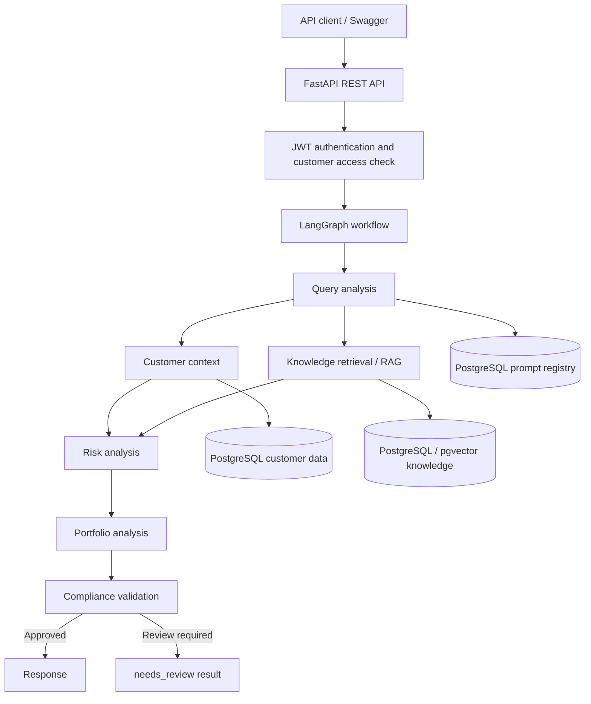
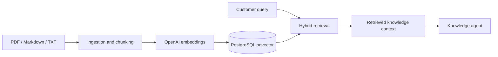

# UK Investment Advisor — Agentic AI System

**Technical architecture and implementation summary**  
**Date:** 4 November 2026  
**Scope:** Local development and components evidenced by implementation discussions. This is not a production deployment or a regulatory approval.

## 1. Project overview

The project is a UK-focused investment guidance prototype built with Python, LangGraph, FastAPI and PostgreSQL. Its purpose is to combine customer context and a retrieval-based knowledge base with specialized agents that analyze investment queries, assess risk, prepare educational analysis and apply compliance checks.

The system is designed to distinguish general investment education from customer-specific guidance and to return a `needs_review` result when suitability or compliance is uncertain. This is an application-level escalation status, **not** a completed human-review queue.

## 2. Implemented architecture

The graph uses a query-analysis step, parallel customer and knowledge retrieval, and subsequent risk, portfolio and compliance steps. A prior local workflow run completed with `status="needs_review"` for a sample customer with aggressive risk tolerance and moderate risk capacity. Subsequent refactoring required import fixes; the current end-to-end test status has not been independently reverified.

## 3. Agent responsibilities

| Component | Function | Output / integration |
|---|---|---|
| Query agent | Interprets investment intent using a versioned prompt and LLM structured output | `intent`, prompt ID/version |
| Customer agent | Retrieves customer profile and financial context from PostgreSQL | Customer context |
| Knowledge agent | Retrieves relevant investment/policy text using RAG | Context and source metadata |
| Risk agent | Examines customer risk tolerance, capacity and suitability factors | Structured risk analysis |
| Portfolio agent | Produces educational investment analysis | Portfolio analysis |
| Compliance agent | Checks suitability, claims and need for escalation | Compliance decision and `human_review_required` |
| Response / review branch | Returns an answer or review-required message | `response`, `status` |

The code uses LangChain `ChatOpenAI` and Pydantic structured output. Consistent state shapes between agents are essential; in particular, `intent` should not alternate between a string and a dictionary.

## 4. RAG knowledge base

The development knowledge base includes separate sample documents on investment education, risk policy, compliance, investment benefits and FCA-related concepts. The ingestion work covers PDF, Markdown and text parsing, chunking, OpenAI embeddings (`text-embedding-3-small`) and PostgreSQL pgvector storage. The retrieval design uses vector and lexical/hybrid retrieval with reranking components.

**Boundary:** The documents are development examples, not verified current FCA policy. Retrieval quality and reranker behavior have not been reported as independently benchmarked.

## 5. PostgreSQL data model

Customer tables developed in the project:

- `customers`
- `customer_employment`, `customer_finances`, `customer_liabilities`
- `customer_goals`, `customer_investments`, `customer_preferences`, `customer_risk_profiles`

Authentication tables created locally:

- `api_users`: username, password hash, active status
- `api_user_customers`: maps API users to permitted customer IDs

Prompt management uses an `agent_prompts` table with agent name, version, prompt content and active version. Sample customer `CUST-003` was used to exercise the risk-mismatch scenario.

## 6. FastAPI and authentication

The FastAPI implementation includes:

| Method | Route | Purpose |
|---|---|---|
| GET | `/health` | Health endpoint |
| POST | `/api/v1/auth/login` | Username/password authentication; JWT issuance |
| GET | `/api/v1/auth/me` | Current authenticated user |
| POST | `/api/v1/investment/analyze` | Customer authorization followed by LangGraph execution |

Password hashing uses Argon2 through `pwdlib`; access tokens use PyJWT. Authorization checks `api_user_customers` before the graph runs. The authentication tables were created successfully during local setup. Full successful login-to-analysis execution has not been confirmed in the discussion, so it is **not claimed as validated**.

## 7. Prompt management

Agent system prompts are stored in PostgreSQL and loaded through a shared asynchronous helper. Query prompts use explicit delimiters such as `<role>`, `<objective>` and `<instructions>`. The query agent records the resolved prompt ID and version in its output.

Prompt version management is implemented as local application code. Comparative v1/v2 evaluation results have not been established.

## 8. Testing and observability work

- A LangGraph test previously demonstrated escalation to `needs_review` for a risk tolerance/capacity mismatch.
- pytest banking-rule and API test examples have been written as part of the project.
- RAGAS evaluation code has been added, but an observed RAGAS/LangChain dependency import error prevents claiming successful RAGAS scoring.
- LangSmith was selected to replace Langfuse; tracing configuration and instrumentation examples were added, but confirmed trace delivery has not been established.

These are implementation and integration activities, **not** evidence of completed security, accuracy, regulatory or performance validation.

## 9. Risk and compliance behavior

The workflow separates query intent, risk assessment and compliance review. For the sample mismatch scenario (aggressive tolerance versus moderate capacity), the prior graph execution returned `needs_review`. The API example also includes a conservative response when `human_review_required` is true.

The project does **not** include verified regulatory approval, a persisted review queue, a completed adviser-review interface or automated investment execution.

## 10. Implementation snapshot

| Area | Evidence-based status |
|---|---|
| Customer database and sample data | Developed and exercised locally |
| LangGraph multi-agent flow | Prior local test passed; later refactoring/import fixes in progress |
| Knowledge ingestion and retrieval | Code developed; end-to-end quality not benchmarked |
| Prompt registry and version loading | Implemented in local code; import issues addressed |
| FastAPI/JWT authentication | Code written; auth tables created; full E2E verification outstanding |
| pytest evaluation | Starter tests written; complete regression results not established |
| RAGAS evaluation | Integration attempted; dependency error unresolved |
| LangSmith | Selected and configured in code; live traces not verified |
| GCP deployment / CI/CD | Not implemented |

## 11. Next steps — deployment and CI/CD

**Next target: Google Cloud Platform (GCP) deployment and CI/CD pipeline.** This is planned work, not an implemented capability.

Suggested sequence:

1. Stabilize and verify the local FastAPI/JWT/LangGraph flow and automated tests.
2. Build and test a Docker image with reproducible dependency versions.
3. Deploy the containerized FastAPI + LangGraph service to **Cloud Run**, store images in **Artifact Registry**, connect to **Cloud SQL for PostgreSQL** (with pgvector support), and store credentials in **Secret Manager**.
4. Configure **GitHub Actions CI** for linting, pytest, dependency checks and container builds; use **Workload Identity Federation** for Google Cloud authentication without long-lived service-account keys.
5. Add **GitHub Actions CD** to publish images to Artifact Registry and deploy to Cloud Run with approvals, environment promotion and rollback.
6. Add privacy-safe traces, operational monitoring and documented release checks.

These are **planned improvements**, not completed project capabilities.

---
*This summary reflects code and outcomes shared during development; it is not an independent repository audit.*
