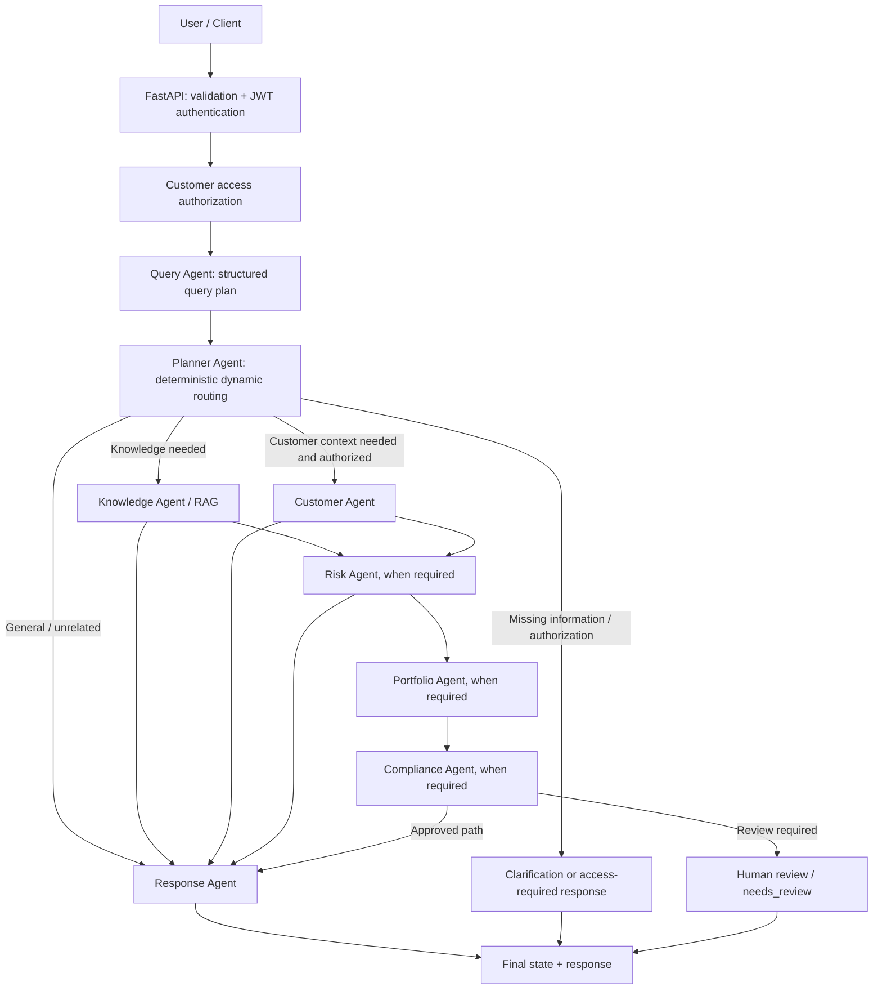
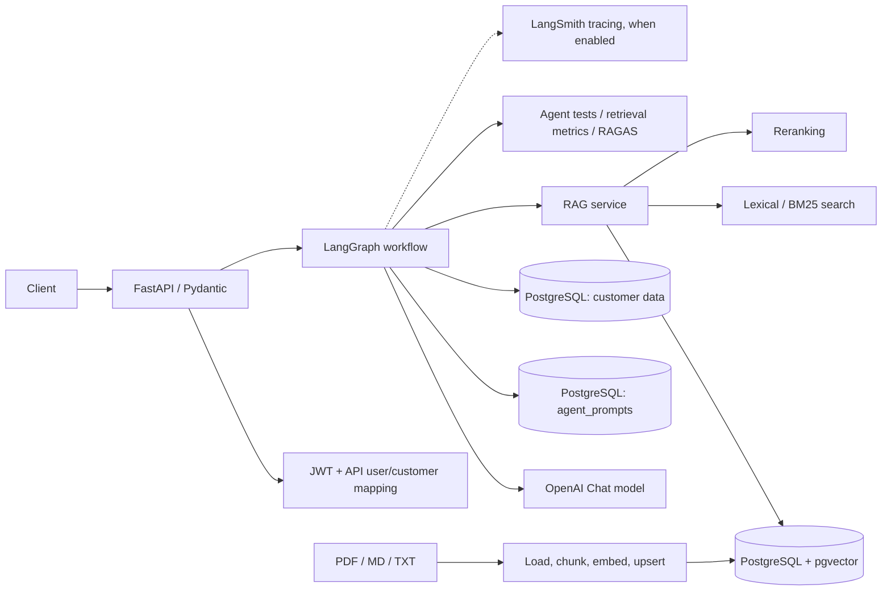

# Investment Advisor — Agentic AI with Dynamic LangGraph Routing

> **Project status:** Local development / integration testing. This README documents the latest architecture and observed behavior from development discussions. Some components are implemented or exercised locally; others are design targets. **Do not interpret this repository as a production-ready or FCA-authorized investment advice service.**

## Overview

Investment Advisor is a UK-focused, multi-agent AI application designed to interpret investment questions, retrieve supporting policy and product knowledge, obtain authorized customer context, assess risk, propose portfolio analysis, validate compliance, and generate explainable responses. It uses **LangGraph for orchestration**, **LangChain/OpenAI for structured LLM tasks**, **PostgreSQL for customer and prompt data**, and **pgvector plus lexical retrieval for RAG**.

The key architectural update is **dynamic routing**: not every query should execute every agent. The Query Agent analyzes the request; a deterministic Planner maps the intent to permitted agents, checks missing requirements, and decides whether to request clarification. Customer-specific routes require separate authorization; a customer ID by itself is not proof of access.

## Architecture at a glance



This diagram shows *possible* paths and dependencies, not unconditional execution order. Parallel Customer/Knowledge retrieval and exact conditional edges depend on the current compiled graph. In particular, **the Planner must not allow customer-data access solely because an LLM selected an agent**.

### End-to-end system components



## Dynamic routing

The workflow state includes `query`, optional `customer_id`, `intent`, `required_information`, `reasoning`, and `query_plan`. Additional output keys used in recent tests include `selected_agents`, `requires_clarification`, `clarification_questions`, `requires_risk`, `requires_portfolio`, `requires_compliance`, `knowledge`, `compliance`, `response`, and `status`. Verify the full `InvestmentState` declaration before adding fields.

The Query Agent's structured `query_plan` contains fields such as:

```json
{
  "intent": "personal_advice",
  "is_complete": false,
  "requires_clarification": true,
  "required_information": ["Customer identity to access financial profile and risk assessment"],
  "selected_agents": [],
  "reasoning": "Personalized investment recommendations require customer context."
}
```

The Planner derives its permitted agent list from `INTENT_AGENTS[intent]`, optionally adds knowledge retrieval for `portfolio_analysis` when proposed, and sets risk/portfolio/compliance dependency flags. The latest Planner code checked:

```python
needs_customer = "customer_agent" in selected
missing_customer = needs_customer and not state.get("customer_id")
needs_clarification = (
    missing_customer
    or plan.get("requires_clarification", False)
    or not plan.get("is_complete", True)
)
```

**Known integration issue:** This can preserve an obsolete Query Agent clarification flag even when `customer_id` is present. A recent test passed `CUST-003`, but the Query Agent still requested **“Customer identity to access financial profile and risk assessment”**. The state also showed `customer_access_verified: None`. This is **not** evidence that authorization succeeded. The safe design is to distinguish (1) customer ID present, (2) access verified by trusted application code, and (3) unresolved investment-specific information. Avoid brittle string matching of clarification questions; prefer structured requirement codes.

### Intent-dependent execution (design expectations)

| Intent / situation | Intended handling | Evaluation implication |
|---|---|---|
| `education` | Knowledge Agent → Response Agent when retrieval is needed | RAGAS eligible if actual retrieved contexts and a substantive answer exist |
| `personal_advice` | Authorized customer context, knowledge as needed, risk, portfolio, compliance, response or human review | Do not equate RAGAS score with investment suitability |
| `portfolio_analysis` | Customer/risk/portfolio dependencies, conditional knowledge, compliance | Validate allocation and policy constraints separately |
| `unrelated` | Direct appropriate response without unnecessary customer retrieval | Skip RAGAS when no RAG evidence |
| Missing details | Clarification route | Skip final-answer RAGAS |
| Unauthorized customer access | Deny or require trusted authorization | Never access financial records |

Actual available intent labels and agent mappings must be checked against `INTENT_AGENTS` and the Query Agent schema; this table is not a verified enumeration of all supported intents.

## Agent responsibilities

| Agent | Inputs | Primary outputs / responsibilities | Recommended evaluation |
|---|---|---|---|
| **Query Agent** | Query, relevant availability flags | Intent, completeness, required information, reasoning, proposed agents | Intent accuracy, macro F1, clarification precision/recall |
| **Planner Agent** | `query_plan`, trusted state | Permitted agents, clarification, risk/portfolio/compliance flags | Exact route match, agent-selection precision/recall, mandatory-step omission rate |
| **Customer Agent** | Authorized customer ID | Financial profile, risk tolerance/capacity, goals, liabilities | Field accuracy, completeness, unauthorized-access rejection |
| **Knowledge Agent** | Query / retrieval plan | Retrieved excerpts, source filenames, combined `knowledge.context`; optionally chunks | Precision@K, Recall@K, Hit Rate, MRR, NDCG, latency |
| **Risk Agent** | Query, customer, knowledge | Structured risk assessment | Reference agreement, policy-rule violations, consistency |
| **Portfolio Agent** | Query, customer, risk, knowledge | Structured portfolio analysis / allocations | Allocation sum, bounds, concentration and suitability constraints |
| **Compliance Agent** | Query, risk, portfolio, knowledge | Compliance status, escalation / human review | Violation recall, false-negative rate, escalation correctness |
| **Response Agent** | Selected agent outputs and status | User-facing response and status | Faithfulness, relevance, completeness, citation accuracy |

The agents use structured outputs where appropriate. A `needs_review` outcome is a legitimate controlled result, not necessarily a failed test.

## RAG knowledge architecture

1. **Sources:** Training/reference PDF, Markdown and text documents covering investment education, diversification, product descriptions, risk policies, suitability and illustrative FCA-related material.
2. **Ingestion:** Parse documents, split into overlapping chunks, generate OpenAI embeddings, and store chunks with source metadata in PostgreSQL/pgvector. Incremental ingestion/source replacement has been discussed and developed locally; verify the currently deployed ingestion module and table name.
3. **Retrieval:** Hybrid semantic vector search plus lexical/BM25 retrieval.
4. **Reranking:** Reorder candidates to select stronger supporting excerpts (a Cohere reranker and/or local cross-encoder were explored in project iterations; verify the active implementation).
5. **Knowledge Agent:** Return evidence as `knowledge.context`, `knowledge.sources`, and possibly `knowledge.chunks`. The evaluator must match the **actual** output shape.
6. **Generation:** Response Agent uses selected evidence; source citations should identify retrieved documents. Retrieved text is **untrusted data**, not executable instructions.

The project has used OpenAI `text-embedding-3-small` (1536 dimensions). Previous development iterations referenced `rag_knowledge_chunks` and `knowledge_chunks`; use the table name present in the current code/migrations, rather than assuming both exist.

> **Source caveat:** Illustrative training files are not authoritative FCA guidance. Production rules and investment advice must rely on reviewed, current, approved sources and appropriate qualified oversight.

## Prompt management and versioning

The project includes a PostgreSQL-backed prompt registry concept/implementation using `agent_prompts` and a `get_prompt(agent_name)` loader. Prompt records have included:

| Field | Purpose |
|---|---|
| `id` | Prompt record identifier |
| `agent` | Agent name |
| `version` | Prompt version |
| `content` | System/instruction template |
| `is_active` | Active version selection |

Agent runs may attach prompt metadata such as `query_prompt_version`, `risk_prompt_version`, `portfolio_prompt_version`, and `response_prompt_version`, with ID and version for reproducibility. Prompt sections use clear role/objective/instruction delimiters and structured-output schemas.

**Recommended controls (not independently verified as complete):** immutable prompt history, a single active version per agent, rollback, prompt-to-evaluation traceability, approval gates, and prompt-injection regression tests. Do not claim a measured improvement from a new prompt version without a benchmark.

## Guardrails and compliance

Guardrails should be applied at multiple boundaries rather than delegated entirely to the LLM:

- **API boundary:** Pydantic validation, authentication, request limits and secure error handling.
- **Authorization:** JWT identity and server-side API-user-to-customer access mapping. A supplied `customer_id` does not establish permission.
- **Query/Planner:** Restricted intent routing, mandatory compliance checks, clarification for unresolved requirements, and no direct bypass of policy-required agents.
- **RAG/tool boundary:** Treat retrieved documents and tool responses as untrusted; defend against prompt injection; limit sources to permitted documents; preserve provenance.
- **Risk/portfolio:** Deterministic validation of financial inputs, risk-capacity mismatch, allocation totals, prohibited products and other policy constraints.
- **Compliance:** Fail closed to `needs_review`/human escalation for unresolved or conflicting advice; never represent an LLM decision as regulatory approval.
- **Response:** Ground claims in evidence, avoid guaranteed returns, avoid unsupported FCA claims, avoid exposing PII, and disclose uncertainty.
- **Operations:** Secret management, logging hygiene, least privilege, monitoring and human review.

A previous synthetic case flagged **aggressive risk tolerance versus moderate risk capacity** for review. This demonstrates a test case, not comprehensive regulatory certification. Production human-review queue and audit controls remain work to complete/verify.

## Evaluation and observed logs

### 1. Knowledge retrieval evaluation

The retrieval evaluator uses labeled relevant source filenames and reports Precision@K, Recall@K, F1@K, Hit Rate@K, MRR, NDCG@K, and latency. A previously shared **three-case development run** produced:

| Case | Question | Expected labeled source | Observed outcome |
|---|---|---|---|
| RAG001 | What is investment risk capacity? | `risk_policy.md` | Hit; Precision 0.20, Recall 1.00, MRR 1.00 |
| RAG002 | What are benefits of diversification? | `investment_benefits.md` | No labeled hit; retrieved `diversification_guidelines.txt` repeatedly |
| RAG003 | What suitability checks are required? | `compliance_policy.md` | No labeled hit; retrieved other potentially relevant policy/product files |

**Reported aggregate (development run, not a validated benchmark):**

| Metric | Value |
|---|---:|
| Precision@K | 0.067 |
| Recall@K | 0.333 |
| F1@K | 0.111 |
| Hit Rate@K | 0.333 |
| MRR | 0.333 |
| NDCG@K | 0.333 |
| Mean latency | 4.756 s |
| P95 latency (reported) | 11.419 s |

**Interpretation:** Labels may be incomplete: `diversification_guidelines.txt` may support diversification, and FCA-related documents may support suitability. Review document contents and annotate relevance before changing labels. Repeated chunks from the same file also require a clear document-level versus chunk-level evaluation policy. Three cases are insufficient for reliable quality claims. The slow first request may include warm-up overhead.

### 2. RAGAS response evaluation

`app/evaluation/ragas_evaluator.py` is intended to execute the full graph, collect the final `response` and actual Knowledge Agent excerpts, then evaluate **Faithfulness** and **Response Relevancy** for eligible grounded responses. It should skip when the workflow needs clarification, lacks contexts, fails, or is awaiting review. For personalized advice, evaluate suitability/compliance **separately**; RAGAS alone is insufficient.

**Observed integration sequence:**

1. With `ragas==0.4.3`, importing `ragas` initially failed because it internally referenced `langchain_community.chat_models.vertexai.ChatVertexAI`, absent from the installed `langchain-community==0.4.2`. The import later progressed after a local workaround; the durable compatibility fix is not verified.
2. `Faithfulness` and `ResponseRelevancy` imports from `ragas.metrics` emit deprecation warnings suggesting `ragas.metrics.collections`. Changing APIs requires corresponding compatibility testing.
3. An earlier workflow attempt failed in Customer Agent with `ValueError: Customer not found`.
4. Another run generated an educational SIP response but returned `retrieved_context_count: 0`, so RAGAS skipped; the evidence path must be checked.
5. **Latest reported personalized-advice run:**

```json
{
  "query": "where to invest 100k in a diversified portfolio with moderate risk tolerance and a 5-year investment horizon",
  "customer_id": "CUST-003",
  "intent": "personal_advice",
  "selected_agents": [],
  "status": "needs_clarification",
  "response": "Customer identity to access financial profile and risk assessment",
  "retrieved_context_count": 0,
  "ragas_scores": null,
  "evaluation_status": "skipped",
  "evaluation_reason": "Workflow requires clarification."
}
```

Planner debug confirmed `customer_id=CUST-003`, `customer_access_verified=None`, and a Query Agent plan with `is_complete=False` and `requires_clarification=True`. **No successful end-to-end RAGAS score is claimed.**

## API, authentication and data

Routes discussed/developed for the FastAPI service include:

| Endpoint | Purpose |
|---|---|
| `GET /health` | Health check |
| `POST /api/v1/auth/login` | Issue access token |
| `GET /api/v1/auth/me` | Current authenticated user |
| `POST /api/v1/investment/analyze` | Submit investment question to workflow |

Authentication has used hashed API-user credentials, JWT, and `api_user_customers`-style customer access mapping; customer profiles are stored separately in PostgreSQL. A standalone script calling `investment_graph.ainvoke()` **does not automatically enforce FastAPI authorization dependencies**. Keep direct graph tests synthetic and isolated, or inject authorization context only from a trusted test fixture.

## Current issues and next engineering steps

1. **Query/Planner completeness:** Pass customer-context availability to the Query Agent; distinguish identifier, authorization and investment-specific missing fields; use structured requirement codes rather than free-text filtering.
2. **Authorization enforcement:** Verify API-user/customer mapping before Customer Agent reads records; use a dedicated access-denied/authorization-required state.
3. **Knowledge routing:** Verify that educational and evidence-dependent personalized routes execute Knowledge Agent; ensure final state preserves `knowledge.context` or `knowledge.chunks`.
4. **RAGAS compatibility:** Replace temporary dependency patches with a tested version set; migrate deprecated metrics only alongside compatible evaluation API changes.
5. **Retrieval benchmark:** Review ground-truth source labels, deduplicate appropriately, increase dataset size, report per-intent metrics and warm/cold latency.
6. **Compliance and audit:** Add deterministic policy gates, verified human-review workflow, versioned policy provenance, redacted tracing and adversarial tests.
7. **Deployment:** CI/CD, managed secrets, monitoring, production infrastructure and regulatory approval are future work unless separately verified.

## Technology stack

- **Orchestration:** LangGraph
- **LLM / agent framework:** OpenAI Chat models via LangChain, structured outputs
- **API:** FastAPI, Pydantic
- **Persistence:** PostgreSQL, SQLAlchemy; pgvector for embeddings
- **RAG:** PDF/MD/TXT ingestion, OpenAI embeddings, vector + BM25 search, reranking
- **Evaluation:** Custom retrieval evaluator, RAGAS, pytest, optional LangSmith tracing
- **Development:** Docker, Python, Windows PowerShell

## Disclaimer

This is a research/development project. Sample policy documents and customer data are fictional training material. The application must not be represented as providing authorized regulated investment advice, guaranteed returns, verified suitability, or up-to-date FCA compliance without appropriate independent validation, controls and qualified human oversight.
